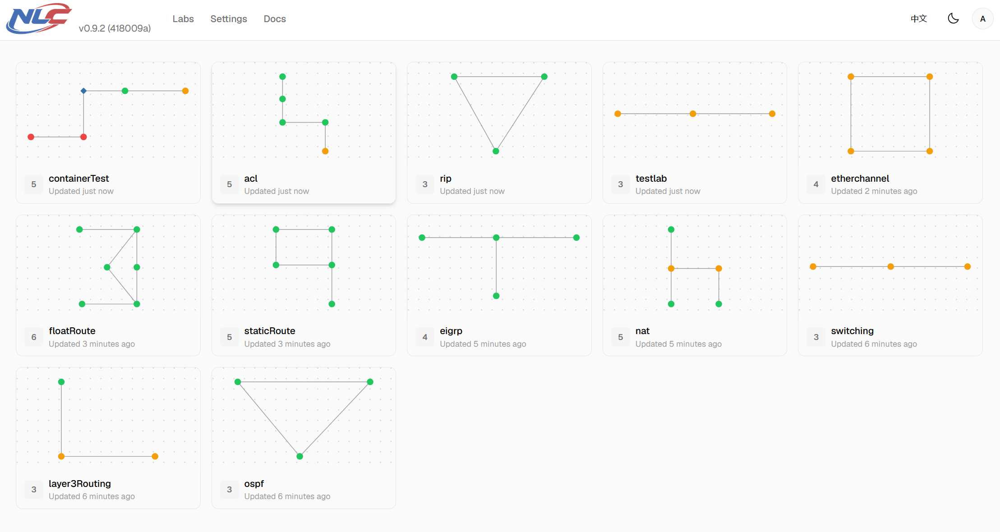
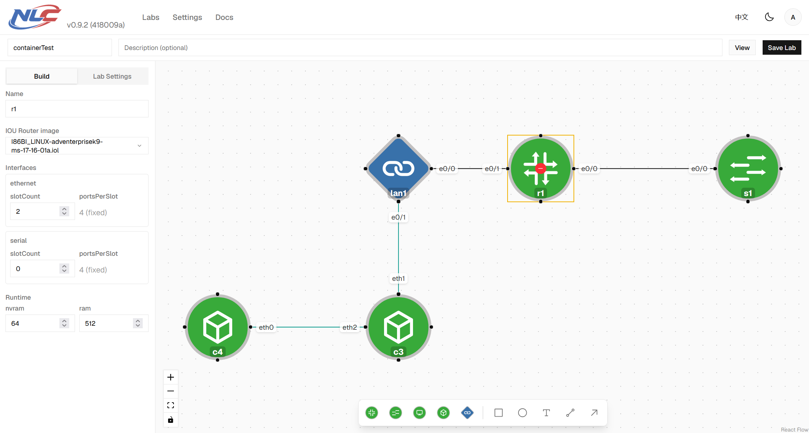
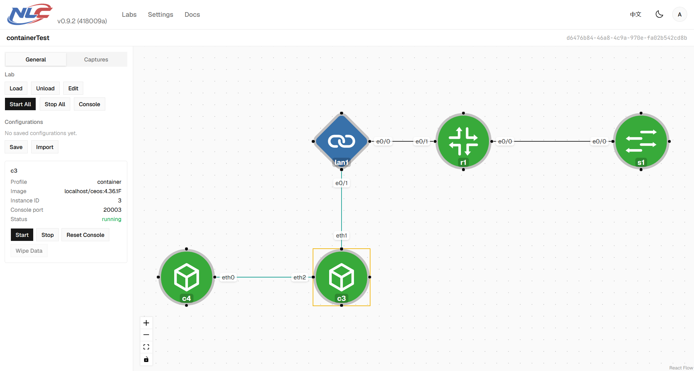
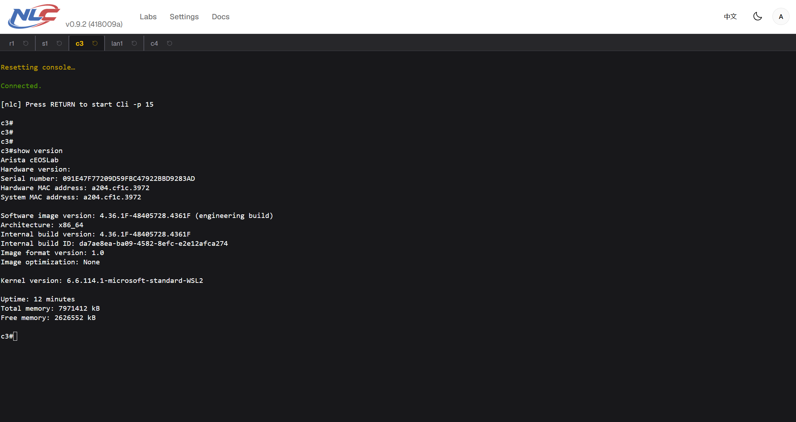
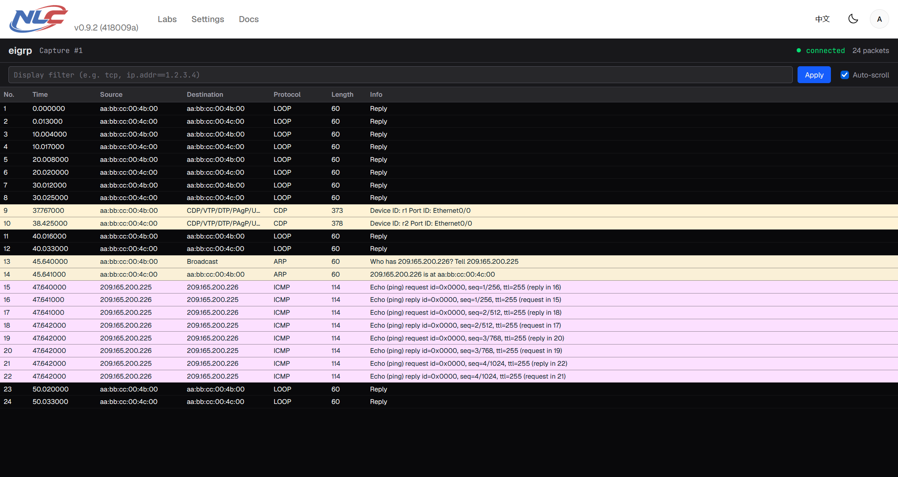

# Network Lab Conductor (NLC)

[English](./README.md) | 简体中文

NLC（Network Lab Conductor）是一个基于前后端分离架构的网络实验平台。旨在提供一个支持Cisco IOU/IOL以及多厂商网络容器（如：Arista cEOS、FRRouting、Juniper cRPD、Cisco XRd等）的编排平台，方便研究者迅速搭建和管理实验拓扑、抓包以及管理配置文件。

## 界面预览

**Lab 列表**——集中管理所有实验拓扑

**拓扑编辑器**——添加节点、连接链路、设置节点属性

**拓扑查看器**——运行 Lab、查看节点状态、管理设备配置

**控制台**——在浏览器中直接操作设备

**抓包**——实时查看链路上的报文

## 使用指南

- [快速入门](./frontend/docs/cn/guide/01-getting-started.md)——首次使用的相关设置
- [拓扑编辑器](./frontend/docs/cn/guide/02-topo-editor.md)——添加节点、连接链路、编辑属性、保存
- [Lab 操作](./frontend/docs/cn/guide/03-lab.md)——加载、卸载、启动/停止节点、应用拓扑变更、保存与恢复设备配置
- [控制台](./frontend/docs/cn/guide/04-console.md)——浏览器终端控制台与外部 telnet 访问
- [抓包](./frontend/docs/cn/guide/05-capture.md)——在 NETIO 链路上实时抓包，支持浏览器内查看器与 Wireshark 流式传输
- [设置](./frontend/docs/cn/guide/06-settings.md)——管理镜像与运行时、后端连接，以及连接到服务器的浏览器 Shell
- [安装指南](./frontend/docs/cn/guide/07-installation.md)——手动在 Linux 上安装 nlc 的环境设置
- [后端内部机制](./frontend/docs/cn/guide/08-backend-internals.md)——命令行层面的底层机制（开发者参考）

## API 参考

- [API 参考](./frontend/docs/cn/api/index.md)——所有 REST 与 WebSocket 接口、请求/响应结构、错误码

## 许可证

NLC 以 [GNU 通用公共许可证第 3 版（GPL-3.0-only）](./LICENSE)发布。随附的第三方组件 `wrapper-linux`（`backend/addons/src/wrapper/`）和 `ioulive86`（`backend/addons/src/ioulive86/`）保留其各自的 GPL-2.0 许可证。

## 法律声明

**不分发任何镜像。** NLC 本身不包含、分发或提供任何设备镜像文件。NLC 使用的所有技术信息均源自互联网上的公开资料。

**镜像与许可证。** 运行设备所需的镜像及许可证须由用户自行合法获取。NLC 不绕过任何许可机制，也不协助获取镜像或许可证。

**合规性。** NLC 主要面向学习与研究场景。用户须自行确保其对各类镜像的使用符合所有适用法律、法规及相关厂商许可条款的规定。
